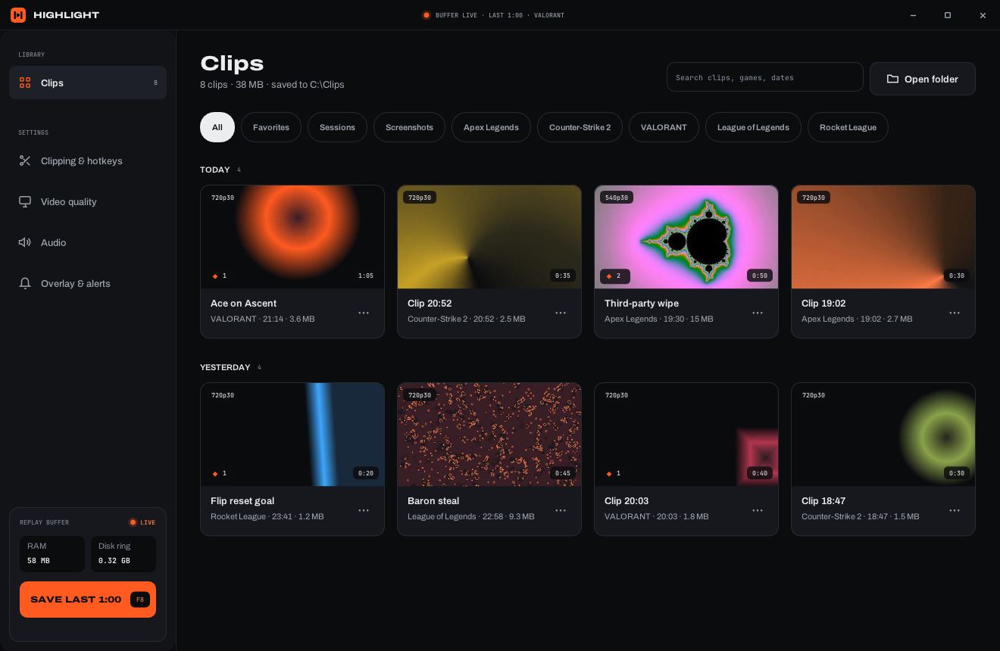
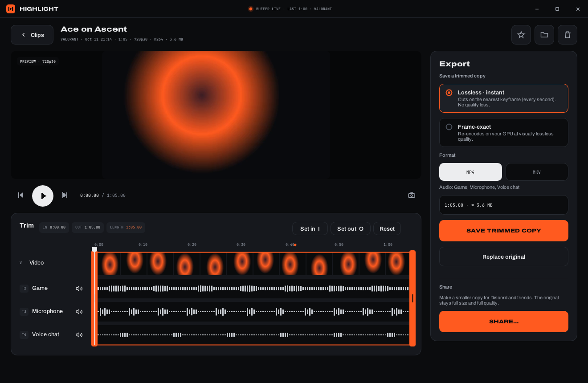
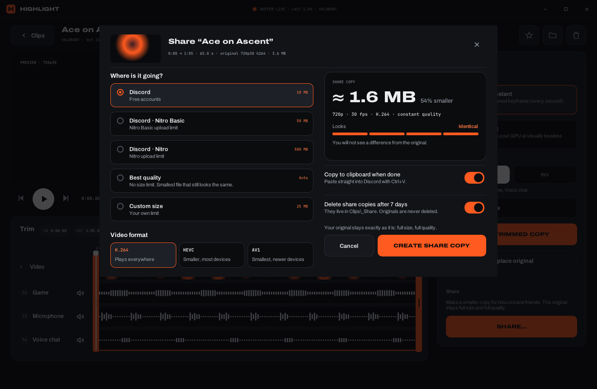
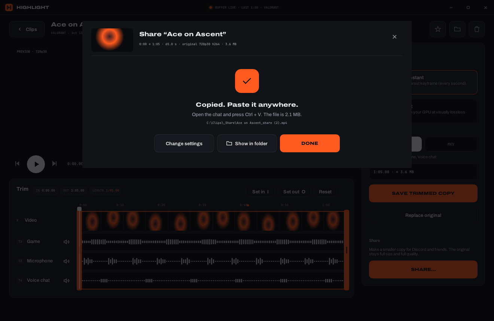
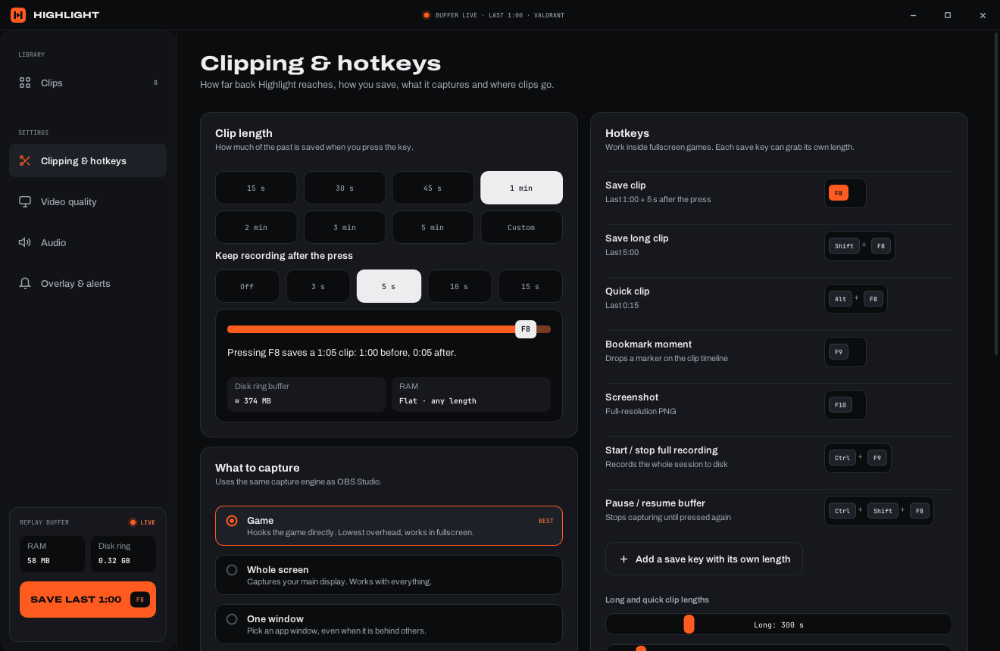
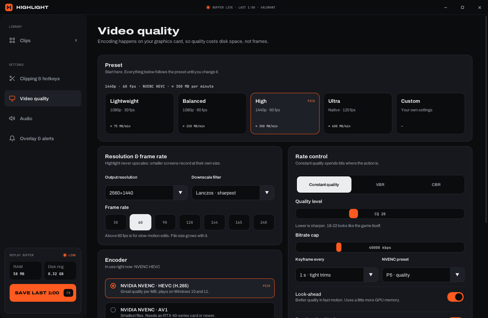
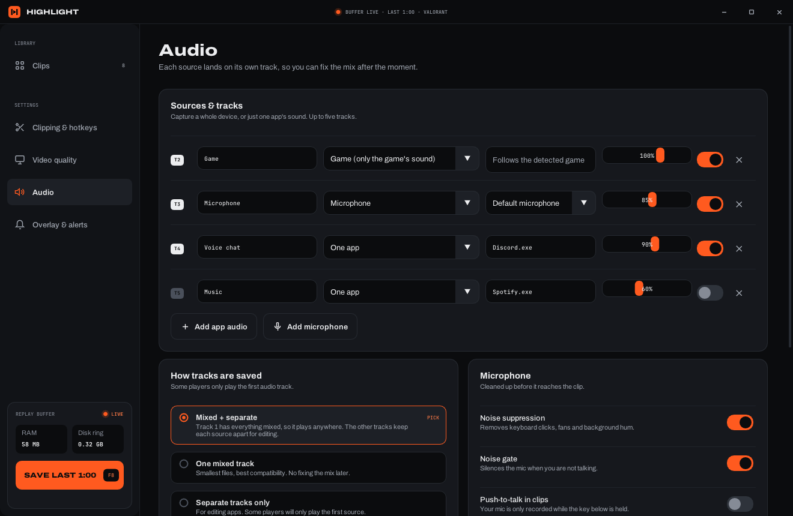
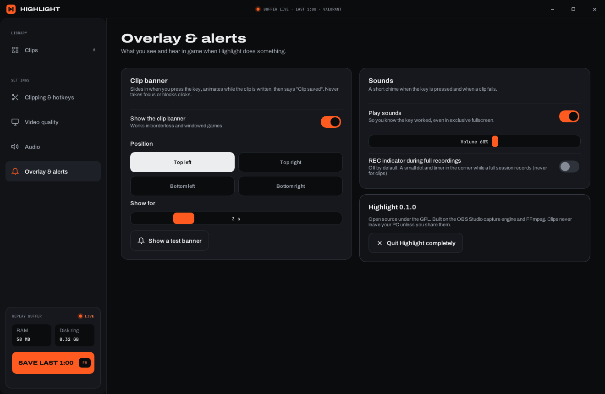

<div align="center">


# Highlight

**Hit the key. Keep the moment.**

A lightweight game clipping app for Windows, built on the OBS Studio capture engine.<br>
It holds the last minute (or five) of your game and saves it straight to your PC when you press a key. Nothing is uploaded.

[](https://github.com/panix8th/clippingpanix/releases/latest)
[](https://github.com/panix8th/clippingpanix/actions/workflows/build.yml)
[](LICENSE)



</div>

## Download

**[⬇ Get the latest version from the Releases page](https://github.com/panix8th/clippingpanix/releases/latest)**

1. Open **[Releases](https://github.com/panix8th/clippingpanix/releases/latest)** and download `Highlight-<version>-windows-x64.zip` from **Assets**.
2. Unzip it anywhere, for example `C:\Games\Highlight`. There is no installer: the folder is the app.
3. Run **`Highlight.exe`**. It sits in the tray and starts recording when a game starts.

Press **F8** in game to save the last minute. Clips go to `Videos\Highlight`.

> **Windows SmartScreen** may say it "protected your PC" because the app isn't code-signed yet. Click **More info → Run anyway**. You can check the source and the GitHub Actions build that produced the zip.

**Requirements:** Windows 10 2004 or newer (64-bit) and a DirectX 11 graphics card. NVIDIA cards (NVENC) are the main target. AMD, Intel and CPU (x264) encoders are used automatically when NVENC isn't there.

<details>
<summary>Want the newest build instead of a release?</summary>

Every push to this repository is built on GitHub Actions. Open the **[Actions](https://github.com/panix8th/clippingpanix/actions/workflows/build.yml)** tab, pick the latest green run, and download the **Highlight-windows-x64** artifact (you need to be signed in to GitHub).
</details>

## The in-game banner


When you press the clip key, a small banner slides in at the **top left** of your screen:

- **While the clip is still being written** it says *Saving clip*, with a spinning icon and a progress bar. Highlight keeps recording for a few seconds after the press (you choose how many), and the bar shows that.
- **When it's done** it turns into *Clip saved* and shows how much you got (**Last 65 seconds · 1440p60 · 84.2 MB**) plus the file name. Then it slides away.
- Bookmarks (F9) get a short *Bookmark added* banner. If saving fails, an error banner tells you why instead of failing silently.

The banner never takes focus or blocks clicks. In **Overlay & alerts** you can move it to another corner, change how long it stays, turn the sound off, or turn the banner off completely.

**No REC dot by default.** Clipping never shows a recording indicator, so your screen stays clean. The optional REC indicator is only for full-session recordings (Ctrl+F9). It's off until you switch it on.

## Screenshots

> The screenshots use sample clips and example values.

<table>
<tr>
<td width="50%"><br><b>Editor:</b> trim, preview, per-track audio, bookmarks</td>
<td width="50%"><br><b>Share:</b> fit a clip under Discord's limit without visible loss</td>
</tr>
<tr>
<td><br><b>Share done:</b> the file is on your clipboard, so just press Ctrl+V</td>
<td><br><b>Clipping & hotkeys:</b> clip length, post-roll, keys, capture source</td>
</tr>
<tr>
<td><br><b>Video quality:</b> presets, resolution, fps, NVENC HEVC/AV1/H.264</td>
<td><br><b>Audio:</b> game, mic, Discord and other apps on separate tracks</td>
</tr>
<tr>
<td><br><b>Overlay & alerts:</b> banner corner and duration, sounds, REC indicator</td>
<td></td>
</tr>
</table>

## What it does

**Clipping**
- Rolling buffer of the last 15 s to 5 min (or any custom length), plus optional "keep recording after the press" post-roll.
- Separate hotkeys for a normal clip (F8), a long clip (Shift+F8), a quick clip (Alt+F8), and up to four extra save keys with their own lengths.
- Bookmarks (F9) that show up as markers on the clip timeline, screenshots (F10), full-session recording (Ctrl+F9), pause/resume (Ctrl+Shift+F8).
- Game capture with auto-detection (starts when a game runs, stops on the desktop), or whole-screen or single-window capture.
- Animated in-game banner and sound when a clip is saved, plus a tray icon with every action.

**Quality**
- Presets from Lightweight (1080p30) to Ultra (native, 120 fps).
- Resolution, 30 to 240 fps, NVENC HEVC / AV1 / H.264, constant quality / VBR / CBR, keyframe interval, NVENC preset, look-ahead, psycho-visual tuning, HDR, MP4 / MKV / MOV.

**Audio**
- Up to five tracks: the game's own sound, any output device, microphones, single apps (Discord, Spotify…).
- "Mixed + separate" layout: track 1 plays anywhere, and the other tracks stay apart for editing.
- Noise suppression (RNNoise), noise gate, push-to-talk for clips, mute mic in clips, AAC or Opus at 128 to 320 kbps.

**Library & editor**
- Thumbnail grid grouped by day, with filters per game, favourites, sessions, screenshots, search and sort.
- Editor with preview playback, frame stepping, trim handles, per-track mute, waveforms and bookmark markers.
- Lossless trim (instant, no quality loss) or frame-exact GPU re-encode. Save a copy or replace the original.

**Share copies (for Discord and friends)**
- Only made when you share. Your original clip always stays full size and full quality.
- Fit under 10 MB / 50 MB / 500 MB or a custom size. Highlight picks the best resolution and frame rate for the limit and encodes on your GPU with quality-focused NVENC settings. If a file overshoots, it retries automatically.
- Or pick "Best quality": a constant-quality copy that looks the same as the original. If that wouldn't be smaller than the original, Highlight uses a lossless cut instead.
- H.264 (plays everywhere), HEVC or AV1. The finished file goes on the clipboard: press Ctrl+V in Discord.

## Why it stays light

- **The buffer lives on your SSD, not in RAM.** OBS's built-in replay buffer keeps the whole clip in memory: about 300 MB for one minute at high quality, 1.5 GB for five. Highlight streams the encoded video into short segment files and deletes old ones as it goes. Saving a clip copies the right segments into an MP4, with no re-encode. Memory stays flat whatever the clip length.
- **Two processes.** `highlight.exe` (capture, encoder, hotkeys, tray) runs in the background. The window (`highlight-ui.exe`) only exists while it's open. Closing it frees its memory.
- **GPU encoding** (NVENC) keeps the CPU free for your game.
- **Only the OBS pieces Highlight needs** are shipped and loaded: game/display/window capture, WASAPI audio, the NVENC/AMF/QSV/x264 encoders, AAC/Opus and the noise filters.

## Folder layout

```
Highlight\
  Highlight.exe            starts everything
  bin\64bit\               highlight.exe (capture), highlight-ui.exe (window), obs.dll, FFmpeg
  obs-plugins\64bit\       the OBS plugins Highlight loads
  data\                    OBS shaders, plugin data, fonts
  licenses\
```

Settings: `%APPDATA%\Highlight\settings.json` · Logs: `%LOCALAPPDATA%\Highlight\logs` · Clips: `Videos\Highlight` by default.

To uninstall, quit Highlight from the tray and delete the folder. Turn off "Start with Windows" in Clipping & hotkeys first so Windows forgets about it.

## Building it yourself

GitHub Actions does all of this for you (`.github/workflows/build.yml`), and pushing a `v*` tag publishes a release. To build on your own PC:

1. Install Visual Studio 2022 (Desktop development with C++), CMake 3.24+, Ninja and Git.
2. Open a **Developer PowerShell for VS 2022** in the repo and run `./scripts/fetch-deps.ps1`. It downloads the official OBS Studio 32.2.2 runtime, the libobs headers from the same tag and OBS's prebuilt FFmpeg (obs-deps). Then it generates an import library for `obs.dll`.
3. `cmake -S . -B build -G Ninja -DCMAKE_BUILD_TYPE=Release`
4. `cmake --build build`
5. `./scripts/package.ps1` assembles `dist\Highlight` and the zip.

## Notes and limits

- Highlight is new (v0.1). If something doesn't work, please open an issue and attach the newest log from `%LOCALAPPDATA%\Highlight\logs`.
- The banner shows over borderless and windowed games. Exclusive-fullscreen games hide it, but the sound still plays.
- Game capture uses OBS's signed capture hook, which most anti-cheat systems accept. If a game blocks it, switch to whole-screen capture.
- Automatic clipping of kills and wins isn't there yet. It needs game-specific integrations.

## Licence

Highlight is free software under the GNU General Public License v2.0 or later (see `LICENSE`), because it links libobs (GPL). It bundles OBS Studio components and FFmpeg (GPL builds from obs-deps), Dear ImGui (MIT), and the Archivo and JetBrains Mono fonts (SIL Open Font License).
